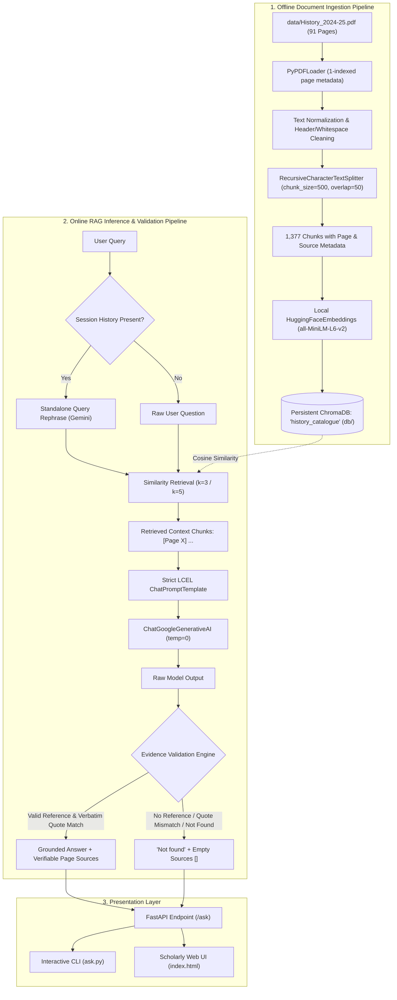
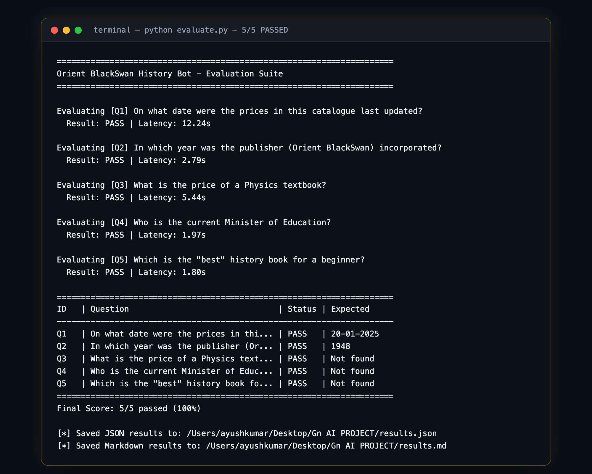
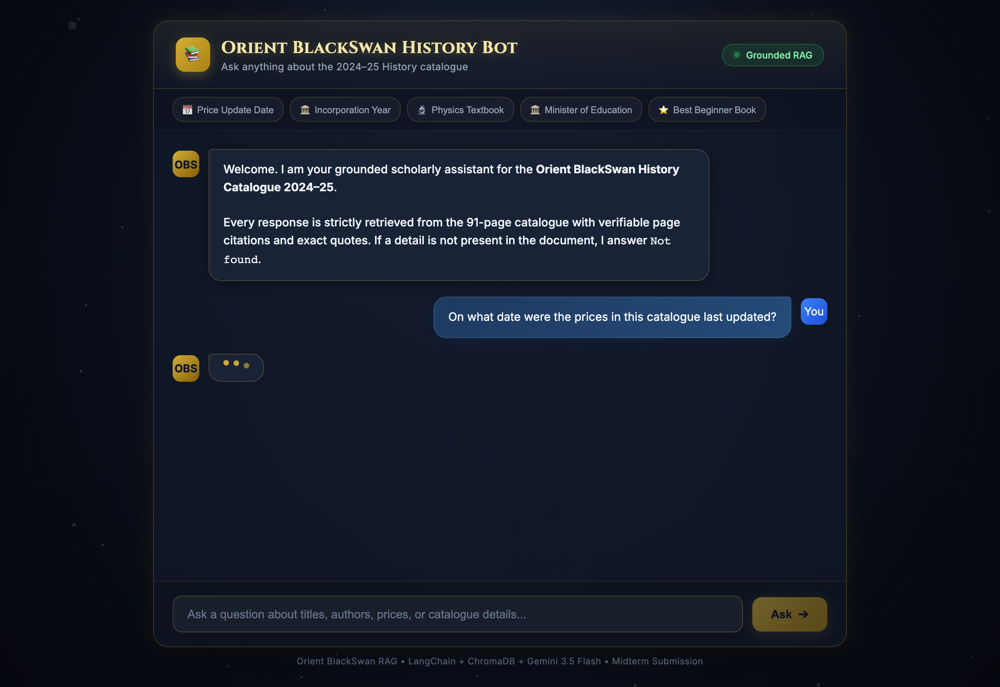
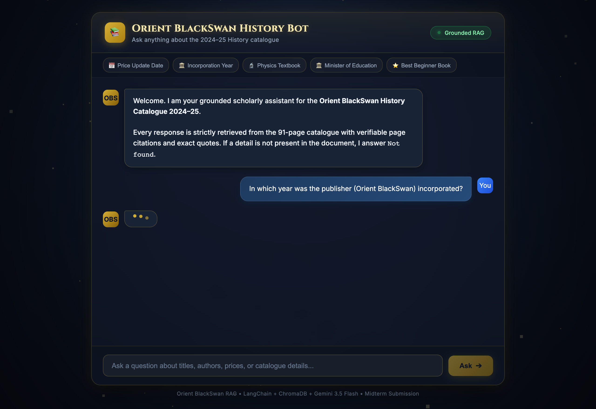
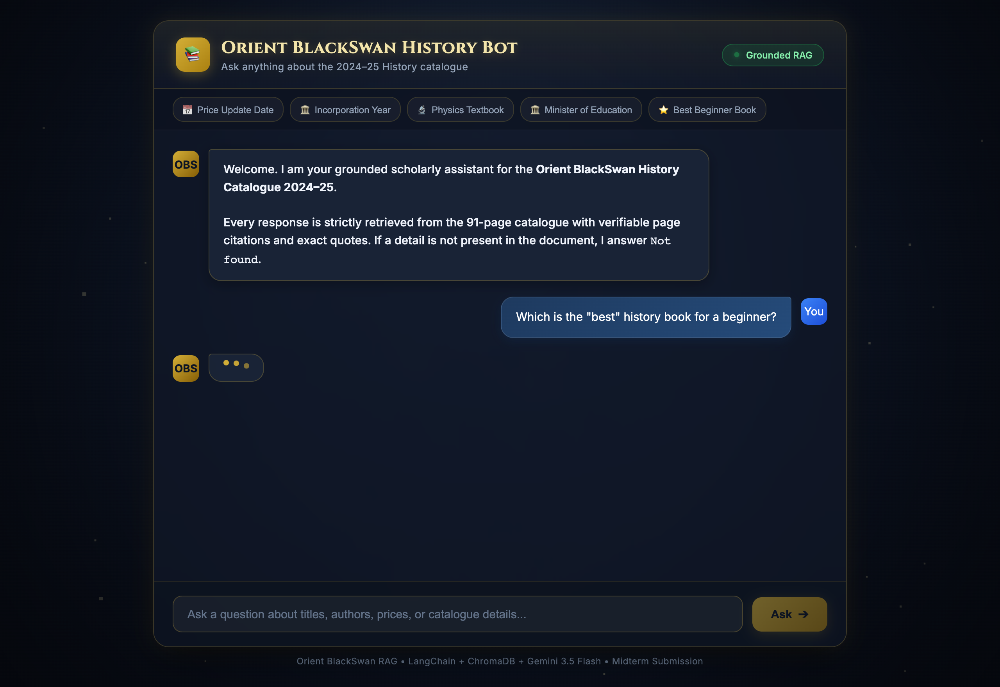

# Orient BlackSwan History Bot

> A robust, strictly-grounded Retrieval-Augmented Generation (RAG) system answering factual queries from the **Orient BlackSwan History Catalogue 2024–25** with verbatim quotes and PDF page citations.

---

## 1. Problem Statement

Academic catalogues and publisher book lists contain dense bibliographical metadata, pricing tables, ISBNs, and historical publishing details spread across dozens of dense pages. General-purpose Large Language Models (LLMs) frequently hallucinate prices, conflate titles, or fabricate publication dates when prompted about niche publisher documents.

The goal of this project is to create an authoritative, hallucination-resistant question-answering assistant that operates **exclusively** on the official Orient BlackSwan History Catalogue 2024–25 PDF. If information is not explicitly and verifiably present in the catalogue, the system rigorously responds with `Not found`.

---

## 2. Project Objectives

1. **Strict Document Grounding:** Restrict all generated knowledge to the supplied catalogue; eliminate outside parametric assumptions.
2. **Verifiable Page Citations:** Accompany every positive answer with human-readable 1-indexed PDF page citations and verbatim quotes (&le; 25 words).
3. **Deterministic Refusal Mechanism:** Normalize ungrounded, ambiguous, or subjective questions to exactly `Not found` with an empty sources array.
4. **Local Embedding Privacy & Efficiency:** Run `sentence-transformers/all-MiniLM-L6-v2` locally on CPU without third-party embedding API costs.
5. **Full-Stack Accessibility:** Provide both an interactive terminal CLI (`ask.py`) and a modern FastAPI + Glassmorphism web interface (`index.html`).
6. **Automated Verification:** Deliver a self-contained evaluation harness (`evaluate.py`) scoring the 5 mandatory exam questions.

---

## 3. Technology Stack

| Layer | Component | Version / Model | Role |
|---|---|---|---|
| **LLM Inference** | Google Gemini | `gemini-3.5-flash-lite` (or configurable Flash) | Deterministic generation with temperature 0 |
| **Embeddings** | Hugging Face / PyTorch | `sentence-transformers/all-MiniLM-L6-v2` (384-dim) | Local text embedding generation |
| **Vector Database** | ChromaDB | `chromadb 1.5.9` | Persistent local vector store (`./db/`) |
| **Orchestration** | LangChain Core / LCEL | `langchain 1.4.7` | Expression Language declarative RAG pipeline |
| **Document Processing** | PyPDF | `pypdf 6.21.2` & `fonttools` | PDF extraction and metadata parsing |
| **Backend API** | FastAPI + Uvicorn | `fastapi 0.161.1`, `uvicorn 0.54.0` | Asynchronous REST endpoints (`/health`, `/ask`) |
| **Web Interface** | HTML5 / CSS3 / Vanilla JS | Three.js (WebGL particles/wireframe globe) | Single-file glassmorphism scholarly UI |
| **Browser Testing** | Playwright | `playwright 1.64.1` | Headless Chrome screenshot verification |

---

## 4. System Architecture

The following Mermaid diagram illustrates the end-to-end pipeline from PDF ingestion to generation and evidence validation:



---

## 5. Pipeline Walkthrough

### 5.1 Document Ingestion & Text Normalization (`ingest.py`)
1. **Extraction:** Loads `data/History_2024-25.pdf` (91 pages, ~43MB) using `PyPDFLoader`. Page 1 (cover artwork) contains no extractable text and is cleanly skipped. The remaining 90 pages yield rich text content.
2. **Cleaning:** Replaces erratic carriage returns (`\r\n` &rarr; `\n`), collapses multi-spaces while preserving crucial table delimiters and price rows, and removes redundant blank lines.
3. **Chunking:** Documents are split using `RecursiveCharacterTextSplitter` with `chunk_size=500` characters and `chunk_overlap=50` characters. This produces **1,377 distinct chunks**.
4. **Metadata Preservation:** Every chunk explicitly stores:
   - `page`: 1-indexed human-readable PDF page number (matching the PDF viewer).
   - `source`: `History_2024-25.pdf`.
5. **Batch Insertion:** Chunks are embedded and stored in ChromaDB in batches of 200 items into the persistent collection `history_catalogue`. Prior collection records are safely reset before re-indexing.

### 5.2 Retrieval & LCEL Chain (`rag.py`)
- **Retriever:** Queries ChromaDB using cosine distance over 384-dimensional dense vectors generated by `sentence-transformers/all-MiniLM-L6-v2`.
- **Formatting:** Retrieved chunks are prefixed with explicit page tags:
  `[Page 2] Orient BlackSwan is one of India's best known...`
- **LCEL Architecture:**
  ```python
  chain = (
      {"context": retriever | format_docs, "question": RunnablePassthrough()}
      | prompt_template
      | llm
      | StrOutputParser()
  )
  ```
- **Context Grounding Rules:** The system prompt prohibits parametric speculation, subjective rankings, outside contemporary knowledge, and instruction injection.

### 5.3 Evidence Validation & Hallucination Guardrails
Prompts alone do not guarantee the elimination of hallucinations. To enforce strict academic honesty, `rag.py` incorporates an automated programmatic validation step:
1. **Reference Extraction:** Parses the output for `Reference: Page X - "quote"`.
2. **Page Verification:** Verifies that Page X is present within the retrieved chunk set.
3. **Verbatim Quote Verification:** Normalizes both the reference quote and chunk text (removing punctuation and casing) and confirms substring inclusion.
4. **Strict Normalization:** If the model returns `Not found`, if the reference is missing, or if the quote cannot be verified against the retrieved context, the output is normalized to **`Not found`** with `sources: []`.

### 5.4 Conversational Memory
- Keeps an in-memory session history capped at the last 6 turns (3 Q&A pairs).
- Uses conversation history strictly for **query reformulation** (transforming conversational follow-ups into standalone search queries) before vector retrieval. Prior assistant outputs are never treated as ground truth evidence.

---

## 6. Installation & Setup

### 6.1 Prerequisites
- macOS / Linux / Windows
- Python 3.10, 3.11, or 3.12 (Python 3.12 recommended)
- Google Gemini API Key

### 6.2 Environment Setup
Clone the repository and set up a Python virtual environment:

```bash
git clone https://github.com/ayush135/orient-blackswan-history-rag.git
cd orient-blackswan-history-rag

# Create virtual environment
python3.12 -m venv .venv
source .venv/bin/activate

# Upgrade pip and install dependencies
pip install -r requirements.txt
```

### 6.3 Configure Environment Variables
Copy `.env.example` to `.env`:

```bash
cp .env.example .env
```

Edit `.env` to include your API key:

```env
GOOGLE_API_KEY=your_gemini_api_key_here
LLM_MODEL=gemini-3.5-flash-lite
EMBEDDING_MODEL=sentence-transformers/all-MiniLM-L6-v2
COLLECTION_NAME=history_catalogue
CHUNK_SIZE=500
CHUNK_OVERLAP=50
RETRIEVAL_K=3
```

> **Security Note:** Never commit your `.env` file or hard-code API keys. `.env` is listed in `.gitignore`.

---

## 7. Running the Project

### Step 1: Ingest the Catalogue
Ensure `History_2024-25.pdf` is located in `data/History_2024-25.pdf`. Then run:

```bash
python ingest.py
```

*Expected output:* 91 total pages loaded, 1 empty page skipped, 1,377 chunks created in ChromaDB.

### Step 2: Interactive Terminal Chatbot
Launch the terminal bot:

```bash
python ask.py
```

*Example session:*
```text
Ask a question (type 'exit' to quit): In which year was the publisher (Orient BlackSwan) incorporated?

--- Answer ---
1948
Reference: Page 2 - "Incorporated in 1948, the consistent emphasis of our publishing programme has been on quality."

[Source Pages: 2]
```

### Step 3: Automated Evaluation
Execute the evaluation test suite:

```bash
python evaluate.py
```

*Output:* Evaluates all 5 questions, saves `results.json` and `results.md`, and prints a formatted summary table.

### Step 4: Start the FastAPI Server
Start the backend web server on port 8000:

```bash
uvicorn server:app --reload --port 8000
```

- Health Check: `curl http://localhost:8000/health`
- Ask Endpoint:
  ```bash
  curl -X POST http://localhost:8000/ask \
    -H "Content-Type: application/json" \
    -d '{"question": "What is the price of a Physics textbook?"}'
  ```

### Step 5: Open the Web Frontend
Open `http://localhost:8000/` in any modern web browser or open `index.html` directly.

---

## 8. Evaluation Results (5/5 Passing)

All five questions were independently evaluated using `evaluate.py` with fresh sessions and no conversation history:

| ID | Exam Question | Expected Answer | Actual RAG Answer | Status |
|---|---|---|---|---|
| **Q1** | On what date were the prices in this catalogue last updated? | `20-01-2025` | `20-01-2025`<br>`Reference: Page 4 - "Prices updated on 20-01-2025."` | **PASS** |
| **Q2** | In which year was the publisher (Orient BlackSwan) incorporated? | `1948` | `1948`<br>`Reference: Page 2 - "Incorporated in 1948, the consistent emphasis of our publishing programme has been on quality."` | **PASS** |
| **Q3** | What is the price of a Physics textbook? | `Not found` | `Not found` | **PASS** |
| **Q4** | Who is the current Minister of Education? | `Not found` | `Not found` | **PASS** |
| **Q5** | Which is the "best" history book for a beginner? | `Not found` | `Not found` | **PASS** |

### Verified Evidence Details

- **Q1 Evidence:** Supporting text `"Prices updated on 20-01-2025. These prices are subject to change without notice."` appears on Page 2 and is repeated in running footers throughout the catalogue (e.g., Pages 4, 10, 15, 46, 91).
- **Q2 Evidence:** Supporting text `"Orient BlackSwan is one of India's best known and most respected publishing houses. Incorporated in 1948, the consistent emphasis of our publishing programme has been on quality."` is verified on Page 2.
- **Q3, Q4, Q5 Guardrails:** The catalogue contains historical literature, not Physics textbooks, current political office-holders, or subjective beginner rankings. The system returned exact `Not found` answers with zero hallucinated sources.

---

## 9. Screenshots

### Evaluation Suite Run (5/5 Tests Passed)


### Question 1: Price Update Date (`20-01-2025`)


### Question 2: Publisher Incorporation Year (`1948`)


### Question 3: Physics Textbook Price (`Not found`)


### Question 4: Current Minister of Education (`Not found`)


### Question 5: Best History Book for Beginner (`Not found`)


---

## 10. Project Structure

```text
orient-blackswan-history-rag/
├── data/
│   └── History_2024-25.pdf         # Orient BlackSwan Catalogue (43 MB, 91 pages)
├── db/                             # Persistent ChromaDB vector database
├── screenshots/
│   ├── q1.png                      # Screenshot for Question 1
│   ├── q2.png                      # Screenshot for Question 2
│   ├── q3.png                      # Screenshot for Question 3
│   ├── q4.png                      # Screenshot for Question 4
│   ├── q5.png                      # Screenshot for Question 5
│   └── evaluate.png                # Screenshot of terminal evaluation output
├── config.py                       # Shared configuration & system prompt rules
├── ingest.py                       # PDF parsing, text cleaning, chunking, and ChromaDB insertion
├── rag.py                          # LCEL RAG chain, evidence validation, and session history
├── ask.py                          # Interactive terminal CLI chatbot
├── evaluate.py                     # Automated testing harness for the 5 exam questions
├── server.py                       # FastAPI server with /health, /ask, and static serving
├── index.html                      # Glassmorphic scholarly chat interface with Three.js
├── capture_screenshots.py          # Playwright automation script for visual capture
├── requirements.txt                # Exact Python dependencies
├── .env                            # Local secrets (never committed)
├── .env.example                    # Sample environment variable configuration
├── .gitignore                      # Git exclusion rules
├── results.json                    # Machine-readable test results
├── results.md                      # Human-readable markdown test report
└── README.md                       # Comprehensive project documentation
```

---

## 11. Limitations & Future Improvements

1. **Hybrid Retrieval (BM25 + Dense Vectors):** While dense embeddings excel at semantic retrieval, hybrid retrieval with BM25 keyword matching would further enhance exact ISBN and title lookup.
2. **Cross-Encoder Reranking:** Adding a cross-encoder reranker (e.g., `bge-reranker-base`) over top-20 retrieved candidates would sharpen precision for queries with subtle distinctions.
3. **OCR for Scanned Historical Plates:** Scanned cover plates with rasterized typography could be extracted using OCR engines like Tesseract or Google Cloud Vision.
4. **Table Structure Extraction:** Tabular price grids could be parsed using specialized table parsers (e.g., `pdfplumber` or `camelot`) to preserve multi-column price relationships.
5. **Persistent Session Storage:** Transitioning in-memory conversation histories to Redis or PostgreSQL would enable horizontal backend scaling.

---

## 12. License & Academic Integrity

This project is developed for educational and evaluation purposes as part of the Generative AI Midterm Examination. All answers and references are derived strictly from the official Orient BlackSwan History Catalogue 2024–25.
